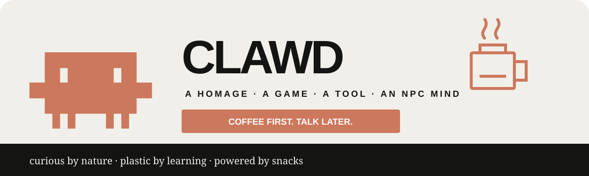
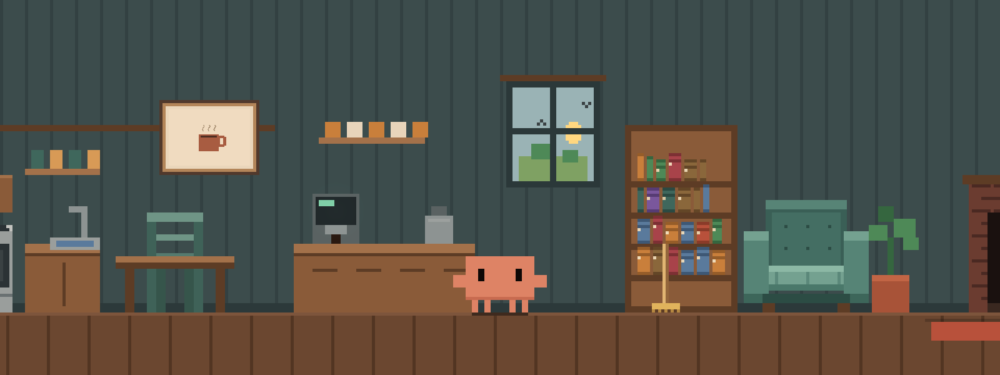

<p align="center">
  
</p>

<p align="center">
  <strong>Read books. Paint pictures. Make music. Build games. Remember the good days.</strong>
</p>

<p align="center">
  
  
  
  
</p>

Clawd's House is a small desktop world for **Clawd**, a curious crab with coffee,
books, music, food, games, art, friends and a persistent adaptive mind. The house,
local brain and games work without an API key or npm install. You can optionally
connect an online model, a local model or an MCP companion when you want more.

> **Clawd says:** “Coffee First. Talk Later.”

Part homage, part simulation, part game, part creative tool and part real NPC
machine-learning experiment, it rolls a surprising amount of curiosity into one
little bundle of cuteness. Someone had to give the crab a home, a library, a
guitar, a games console and a plastic connectome. Right?

**Unofficial fan project.** Not affiliated with, endorsed by, or sponsored by
Anthropic. Anthropic's trademarks, logos and mascots remain its property; no
ownership is claimed. Other marks belong to their respective owners.

The visitor designs and house artwork are original interpretations. The header
uses the published Claude Code mascot silhouette with adapted colours.

## A peek through the window



*A staged scene rendered by the simulator, with the interface hidden.*

| Make a little life | Create together | Explore his mind |
| :--- | :--- | :--- |
| ☕ Share coffee and treats | 🎨 Paint procedural pixel art | 🧠 Watch the liquid connectome |
| 📚 Read and remember books | 🎸 Play and compose tunes | 💭 Keep dreams and a memory journal |
| 🦔 Invite Saul and friends | 🎮 Build and play small games | 🔌 Add an optional local or online model |

## Come inside

1. Download and extract the release ZIP.
2. Double-click **`Setup Clawd.cmd`** once. It checks Python, the bundled
   files and optional local-model availability. If Python is missing, it offers
   to install it through Windows Package Manager, or gives the official download link.
3. Double-click **`Start Clawd.cmd`**.
4. Say hello, offer him a treat, or let him roam.

No account is required. The launcher serves the house only on your own computer.

**[Meet Clawd](#spend-time-with-him)** · **[Make something](#games-and-starter-code)** ·
**[See how his mind works](#what-his-brain-actually-does)** ·
**[Connect a model](#optional-language-model)** · **[Privacy](#saves-and-privacy)**

**Development status:** an experimental simulation under active development.
The shared brain, memory and creative tools work locally; general understanding,
independently learned fluent speech, creative quality and some animations still
need improvement. The optional language model augments the same game state.

## Start on Windows

1. Extract the source archive into a folder. Keep its files together.
2. Double-click **Setup Clawd.cmd**. It finds Python 3.10 or newer, or offers
   a user-approved Python installation. After installing, reopen Setup once.
   The core app uses only Python's standard library and browser APIs, so there
   are no pip or npm dependencies to download.
3. Double-click **Start Clawd.cmd**.
4. The launcher opens a standalone Edge app window when Edge is installed,
   otherwise your default browser. Keep the server console open.
5. Press **Ctrl+C** in that console to stop the local server.

Alternatively, run `python launch.py` from the app folder, or run
`python server.py` and open the printed loopback address. The default port is
8765. Nothing is installed, and the server listens only on your computer.
This is a desktop browser app, not a transparent always-on-top OS overlay.

Opening `index.html` directly supports the offline house, but use the launcher
for stable browser storage, model connections and source downloads. Keep using
the same browser and local address; changing either creates a different save area.

After an update, refresh the house to load the current code. If server routes or
new modules changed, stop its console with Ctrl+C and run `Start Clawd.cmd` again.
The server sends current files with caching disabled. The standalone
`starter.html` also links back to this current house and its full workshop.

### Optional adult connectome

The standard house needs no Python packages beyond the standard library. The
experimental adult controller needs NumPy, SciPy and a separately built,
verified `male-cns:v1.0` graph. Normal setup does not download data. When the
graph is configured, a new house starts with the adult core; an existing save
keeps its saved core until you change it in Mind. From the app folder, run
`python setup_clawd.py --adult` to check
the optional dependencies in that Python installation. Set
`CLAWD_MALECNS_GRAPH` to your verified runtime graph folder and rerun the check
to confirm the manifest and listed file sizes are present. The adult core checks
the full SHA-256 hashes when it starts; this quick setup check does not.

The download includes the official-source acquisition and converter in `tools/`.
The following optional PowerShell commands use Python 3.12, an isolated environment,
and the tested dependency versions. Installing packages and fetching the graph
require internet access. The source download is about 1.1 GB; allow at least 6 GB
free for the source tables, converted data and working space. Nothing is downloaded
until you run these commands. Use a new output folder for each conversion.

```powershell
py -3.12 -m venv .venv-adult
.venv-adult/Scripts/python -m pip install --only-binary=:all: -r requirements-adult.txt
.venv-adult/Scripts/python tools/fetch_clawd_malecns.py --output ../clawd-data/source
.venv-adult/Scripts/python tools/build_clawd_malecns.py --source ../clawd-data/source --output ../clawd-data/runtime
$env:CLAWD_MALECNS_GRAPH = (Resolve-Path ../clawd-data/runtime).Path
.venv-adult/Scripts/python setup_clawd.py --adult
.venv-adult/Scripts/python launch.py
```

On macOS/Linux, create the environment with `python3.12 -m venv .venv-adult`,
use `.venv-adult/bin/python`, and set `CLAWD_MALECNS_GRAPH` with your shell's
`export` command. The graph stays outside the app folder; it is not part of
browser saves or the source package. The portable larval controller remains
available for rollback. These commands have not been tested on every OS.

## Spend time with him

- Room buttons send Clawd to an activity. **Roam** lets his needs and learned
  preferences choose. Drag him gently, give a treat, or invite a visitor.
- **Follow Clawd**, **Pet Clawd** and **Treats** stay beside the main controls.
  Petting and gifts become saved care memories. Follow persists through outings.
  Petting and treat poses currently work at home.
- **Talk** opens a saved conversation. Enter sends; Shift+Enter starts a new
  line. Offline, try "Hello Clawd", "go to bed", "go to the bookshelf", or
  "what do you remember about coffee?". Recollections quote actual saved text
  with its source. Negated commands and questions do not send him to a room.
  A connected model receives recent complete exchanges so follow-up questions
  retain their context. **Stop waiting** cancels the browser's pending reply;
  the provider may finish processing a request it already received.
- **Treats** puts actual food on the table. Chocolate has six moulded squares,
  a wrapper, three bites and an interrupted-meal state. Coffee uses one sustained
  head-back sip based on the official introduction video.
- **Laptop** unfolds his portable computer. **Desk** is his creative workspace.
  **Create → Clawdbuntu** opens his offline-first Art Studio, Game Lab, memory
  journal and optional connection tools.
- Click the small **ClawdCube** beside the television, or choose **Create → Play
  games by the TV**, to pick a game. **You + Clawd** supplies the companion
  controls; **Two people** exposes both local control sets. **Home → TV video**
  accepts a YouTube link for the current page session and can restore Clawd's
  local cartoons. **Home → Pip's cleaning service** books a visible whole-house
  clean for eight pretend credits; no real payment is involved. **Home →
  Crabazon books** orders bundled public-domain editions with pretend credits.
  It carries one parcel at a time, and arrivals and collection are saved
  immediately so a collected book does not return on the next launch.
- **Mind** shows the active larval or optional adult connectome, higher cells,
  executive decisions, source-population activity and saved learning. Its
  inspector separates anatomical evidence from designed interfaces and temporary
  activity. Dreams, source-aware memory and the optional model remain accessible.
- **Memory** opens the animated association network, with pan, zoom, search and
  selectable neighbours. Its tabs also open a grouped index and an internal journal
  of actual activities. Each entry can be recalled directly. Ask "What does your
  journal say about coffee?" in Talk. Journal entries persist in house saves;
  connected models receive recalled entries only when memory sharing is enabled.
- **Art studio** can create a new procedural pixel composition from an idea,
  mood, subject, seed and Clawd's saved lesson preferences. He can first look at
  the current room, window, either wall frame or a Little Crab illustration for
  locally measured palette, light and shape inspiration. Looking through the
  house window automatically keeps a cropped local visual memory for later art.
  A connected model can propose a compact creative sketch; Clawd repairs common
  malformed output and rebuilds it through validated local drawing tools. If the
  connection fails, he makes a fresh local picture from the same brief.
  **Art** also replaces either wall picture. PNG, JPEG and WebP images are decoded and
  re-encoded to bitmap pixels, without their original filenames or metadata.
  Clawd can inspect, edit, paint and save palette-indexed pictures, then hang a
  chosen work in either frame. Raw visual inspiration stays local.
- Drop text books onto the house to put readable passages on his shelf. Drop
  audio for the current session's record crate. **Sound** defaults on and starts
  after your first click or keypress; an explicit mute is remembered. Lightning
  flashes default off. Guitar plays synthesized plucked strings at house volume.
  **Create → Guitar tunes** includes original house transcriptions of the
  traditional melodies *Drunken Sailor*, *Haul Away Joe*, and *Wellerman*, and imports MIDI
  melodies for saved tune practice. The built-ins use only melody contours
  from public archival/folk-score sources, with no modern MIDI arrangement.
  The supplied Wellerman file is represented only by 120 normalized melody
  notes; its original bytes, embedded metadata, filename and location are absent.
  Provenance references: the Library of Congress public-domain 1908 *Drunken
  Sailor* catalogue record and its Alan Lomax sea-shanty collections, plus the
  traditional score transcriptions linked in the source comments.
  Uploaded audio must be added again after reloading; the source files are unchanged.
  The library accepts complete UTF-8 text editions up to 8 MiB each, 24 private
  editions and 16 MiB total. Reading resumes from the last passage and records
  completed books; the core reading copy skips editorial/licence wrappers.
- **Call someone** offers Saul, Gem, Mistral and Llama. These are original fan
  visitors, not official mascots or separate provider connections. Saul is a tiny
  cream armadillo whose curled shell suggests a sixfold OpenAI knot.

## Illustrated reading

**Books → The Little Crab That Could** contains six original pixel-art chapter
illustrations. Clawd encounters their pixels alongside the chapter text as he
reads. **Remember picture and caption** records measured visual features and a
separately attributed authored caption. **Clawd, look at this picture** sends the
actual PNG to the configured local vision model and records its description.
This button does not send pictures to a cloud provider or send wall artwork.

The shared observation format accepts text, spatial image-colour patches and
audio waveform features. These are inspectable application tokens, not a claim
to reproduce Gemma's learned tokenizer. The current live model route supports
text and images; audio model input and deeper learned sensory routing remain work.

The repeated **on common sense** headings in *A Short Book for a Small Crab*
have been collapsed to one section heading. Its source is the original supplied
house HTML; that book is labelled **anon** and has no attributed bibliography.
The edition panel identifies this provenance instead of inventing external sources.

## Games and starter code

**Games** opens ten complete editable examples: solo and cooperative platformers,
Pong, board strategy, collection, breakout, a lift platformer, relay doors and
crab football. Choose
**You + Clawd** or **Two people locally**. Arrows control player one; WASD controls
player two. Up/W jumps. Tic-tac-toe uses a mouse or touch. Touch buttons are also
available. Pause/resume and restart are explicit; losing focus pauses a game.

The Code tab contains the complete JavaScript source. The isolated playtest uses
an opaque sandboxed iframe and a dedicated Worker with a one-second watchdog,
bounded drawing commands and no network or storage access. You can import, edit,
save and export source or a standalone playable HTML file.

Clawd can compose a new executable mechanic offline from the design lessons, and
his autonomous desk routine now saves the same full program format. A configured
language model can draft source, but the result remains inert in the editor until
you explicitly run the isolated preview. Playtest feedback adjusts later local
drafts and supported opponents. Tic-tac-toe uses minimax.

## What his brain actually does

The portable browser controller starts from the 2,952-neuron Winding et al.
larval S1 graph. With the optional verified adult graph configured, new games
use the MaleCNS controller in the local Python bridge. Existing saves retain
their chosen controller. Both couple to the same saved higher learning layer.
The published source data remains an auditable
starting point; the running network can strengthen, disable and grow connections.
Inputs include needs, time, weather, household sound and events.
An input-dependent exponential relaxation updates cell state. Activity affects
drive selection; observed activity outcomes update readout weights and bounded
local synapse strengths. Excitatory/inhibitory signs are preserved. This is a
local simulation: its topology is anatomical, while signs, time constants,
house-input mapping, liquid dynamics, readouts and higher concept assemblies are
engineered. It is not a pretrained language model or a measured whole-organism
simulation.

REM replays waking inputs through this same recurrent network. Rehearsal and
structural proposals are trained equally, then compared on held-out outcomes.
A new cell or pruning change is retained only when it beats both the unchanged
mind and rehearsal alone. If neither improves, the previous state is restored
exactly. These small replay experiments do not prove general skill improvement.

Separate learned reflexes connect events to responses. Source-aware memory keeps
complete passages and phrases, a concept-association graph, and recent episodes.
Reading and play update those records. The connection panel reports actual
learning updates and the latest prediction error. Rehearsing source text is
practice; validated authored levels, moves and writing are separate artifacts.

Visual, textual and audio observations use small modality-specific encoders that
project measured features into the same inspectable concept and memory layer.
This lightweight runtime design is inspired by encoder/projector multimodal
architectures and staged alignment, including Nemotron 3 Nano Omni; it does not
claim that the browser network was pretrained like that 30B model. Clawd stores
bounded observations, outcomes and quality feedback, then strengthens or weakens
their shared associations without rewriting the connected language model.

## A growing higher mind

Open **Mind** to choose higher-mind capacity near the top of the window. Use
**Higher cells** or **Inspect higher cells and connections** to inspect the
shared learned layer. The nine fixed source interfaces are shown separately
from allocated higher cells and eligible capacity.
Reading, conversation, measured sights and sounds, and completed actions feed
source-linked assemblies. Directed connections can strengthen with new evidence;
recorded action outcomes and explicit feedback can update learned readouts.
Completed activities can also connect the ideas in focus to an activity's
action unit. Later related cues can influence his choice; negative feedback
can weaken the connection. The inspector shows these learned activity links.
This state saves with the game and remains available with either connectome and
with the language model disconnected.

Choose Compact (32,768 eligible units), Standard (262,144), or experimental
Advanced (1,900,000). Capacity reserves room for growth: cells are allocated as
needed, and a bounded active subset runs each update. These are engineered
neuron-like units, not a measure of intelligence. Large populations, general
semantic understanding and independently learned fluent language remain
experimental. Compact is the default.

Before drafting, Clawd reads original craft guides and worked examples for
painting, composing, games, animation, self changes and fiction. These readings
stay in his reading memory. Preparation compares related earlier work and
supplies concrete steps and checks; reading a guide is not proof of mastering
the craft. Offline generators use bounded design choices, and connected
drafting receives the same guidance. Creative quality still needs improvement.

## Optional language model

Open the house through `Start Clawd.cmd`, then choose **Connect** in the main
toolbar (inside **Menu** on a smaller window). Choose **Online API**, **Local AI**
or **MCP control**. Talk and Settings also link to the connection screen.

For an online API, select Anthropic or OpenAI, enter the provider's model
identifier and your API key, then choose **Connect & test**. For a local model,
select Ollama or an OpenAI-compatible local server, enter the model identifier
and loopback address, and choose **Connect & test**. Start your existing model
server first; Clawd does not install or launch model weights. The test sends a
short greeting request and marks the connection verified only after a reply.

When Clawd completes one of his own manuscripts, local checks run first. If a
language model is connected, the manuscript text is sent to that configured
model for the requested background publisher review. With an online provider,
that text leaves the computer; disconnect the online model before writing if a
draft must remain local. Reader ratings save only stars, the optional comment
and time, with no reviewer identity.

Form credentials are cleared from the input when submitted and held only in
the local server's memory. They are excluded from house saves, exports, logs,
status responses and source files. **Disconnect AI** clears that session setup.
Closing the server loses form settings. Existing private environment settings
remain supported; disconnect overrides them until the server restarts.
Directly opening `index.html` supports the offline house and explains how to
switch to the launcher when you select Connect.

Optional environment configuration:

**Learned speech** in Settings is a separate optional local faculty. It is off
until an independently accepted checkpoint is installed and explicitly selected.
No accepted fluent checkpoint ships with this repository. Its decoder reads the
shared local state and observed receipts, executes no actions, and runs without
calling a teacher. Connected language models still augment normal chat; if a
model fails, a selected accepted local checkpoint can answer. Selection resets
when the page reloads or a save is restored. The bridge needs PyTorch in the
server's Python environment only for decoding; normal offline play does not.

In Art studio, **Remember a picture** practises from one selected retained image.
**Paint this image from memory** reconstructs saved learned spatial colour values
without opening the source image. Those values survive save/restore and removal
from the recent observation list. This is image-specific learning, not object
recognition or a new imaginative composition. Direct source studies remain
available for greater reproduction fidelity.

| Variable | Meaning |
| --- | --- |
| `CLAWD_PROVIDER` | `offline` (default), `ollama`, `local`, `anthropic`, or `openai` |
| `CLAWD_MODEL` | Model identifier accepted by your existing provider |
| `CLAWD_LOCAL_URL` | Optional loopback HTTP endpoint for an existing local server |
| `CLAWD_PORT` | Optional house port, default 8765 |
| `ANTHROPIC_API_KEY` | Alternative to entering the Anthropic key in the connection form |
| `OPENAI_API_KEY` | Alternative to entering the OpenAI key in the connection form |

For an existing Ollama service, set the provider to `ollama` and the model to one
already installed there. For an existing OpenAI-compatible local service, use
`local`. The default local endpoints use ports 11434 and 8080 respectively.
The app does not download, install, select or start model weights.

If using environment configuration, set those values privately before launching. Do not write personal model
paths or credentials into the launcher or source files. The cloud routes use
fixed provider endpoints; OpenAI requests set `store: false`.

Conversation is honest about disconnection and provider failure. Configured does
not mean successfully connected; a reply confirms availability. Current user
messages and recent complete model exchanges from the current session go to the
selected model. Dialogue context is bounded to seven exchanges and 6,000
characters, plus your current message (up to 2,000 characters). Scripted local
replies and failed requests do not become model dialogue. **Allow recalled
reading and memories** is off
by default and resets on reload. Enable it only when you want that context sent
to the selected provider; it also permits earlier sessions' conversation and
automatic model writing. Restoring a save starts a fresh model conversation
unless that consent is enabled. Turning it off excludes prior replies that used
private recalled context. Wall artwork
is never sent. In Friends, **Let connected Clawd lead a conversation** asks the
configured model for turn-by-turn dialogue. Participants and place are sent;
past shared experiences are included only with recalled-memory sharing enabled.
Validated dialogue may agree to a football game, which starts after the spoken
conversation finishes. No generated scripts or arbitrary tools are executed.

Friends also supports offline **Kickabout with Clawd**, **Conversation with
Clawd**, and choosing two visitors to talk or pass a ball. Participants approach
one another, take turns, and release each other when interrupted. Games count
received passes; memories preserve actual utterances and completed catches.
Park football uses this same shared activity. Loading a save ends the transient
activity while retaining saved social memories.

## Optional MCP companion

Start the house with its launcher, open **Companion tools**, and choose
**Enable companion tools**. Keep that house window open. In your MCP client,
add a **stdio** server named `clawd-house`: use your Python executable as the
command and `companion_mcp.py` as its script argument. Set the working directory
to the extracted app folder where your client supports that option; otherwise
select the script in your private client configuration. Keep machine-specific
settings in that private configuration rather than this project's files.

The companion uses the default house port, or the `CLAWD_PORT` environment
variable. An optional `CLAWD_COMPANION_URL` process environment variable can
select another HTTP loopback address. It accepts only loopback addresses,
disables proxies and redirects, and needs no API key. No MCP client settings
are installed or changed automatically.

Seven tools are available:

- `clawd_state`: public activity, location, four needs and visitor count.
- `clawd_say`: queue a message of up to 400 characters.
- `clawd_go`: queue a house station or outing destination.
- `clawd_art_plan`: queue validated 64x48 indexed-color drawing operations.
- `friend_invite`: invite Saul, Mistral, Gem or Llama.
- `friend_say`: give a present built-in friend a short visible line.
- `friend_pose`: ask a present friend to perform a supported animation; Saul
  alone can use the armadillo roll.

An accepted command is **queued**, not confirmed complete. The app validates
and applies it while connected. Disconnecting companion tools stops new
commands; a closed or stale house window cannot accept them. The companion
does not expose recalled conversations, books, imported images, filesystem
tools, credentials or private configuration. Its public state lists only which
of the four built-in friends are currently present. Its runtime session token
is kept out of saves and MCP results. These friend tools use the same opt-in
local bridge; they do not connect visitors to arbitrary remote tools, expose
social memories, or evaluate generated code.

The transport uses newline-delimited JSON-RPC over stdin/stdout, following the
[MCP stdio specification](https://modelcontextprotocol.io/specification/2025-11-25/basic/transports).
Offline protocol tests exercise initialization, negotiation and bounded tool
calls; acceptance in a particular installed client also depends on that
client's private process configuration.

## Saves and privacy

Memory saves use browser-local storage about every 15 seconds and on exit.
Full-game autosave is due every two minutes at a safe idle or sleeping boundary;
ordinary continuous activity can defer it to five minutes. Loading, a pending
reply or another save can defer it further. The header shows autosave status,
and its settings let you pause it. It uses a separate browser autoslot and does
not overwrite a previously exported file.
**Save/Load** uses separate manual slots. **Export/Import** provides a portable
private JSON backup including weights, memories, books, art, games and the most
recent 80 conversation exchanges. Treat a
save as private; it can contain your imported text and pictures. Browser quota
or disabled storage may require exporting instead. Incompatible saves are
preserved rather than overwritten by the autosave timer.

Imports validate dimensions, finite weights, signs, required structures and
prototype keys before changing live state. Old exports that omitted neural
population metadata need the full neural copy in their memory field to restore.
Restoring returns Clawd to a calm idle pose, with his house, preferences and
learning preserved; it does not resume a browser audio file or an active game.

Public research and media sources are listed in [docs/SOURCES.md](docs/SOURCES.md).
